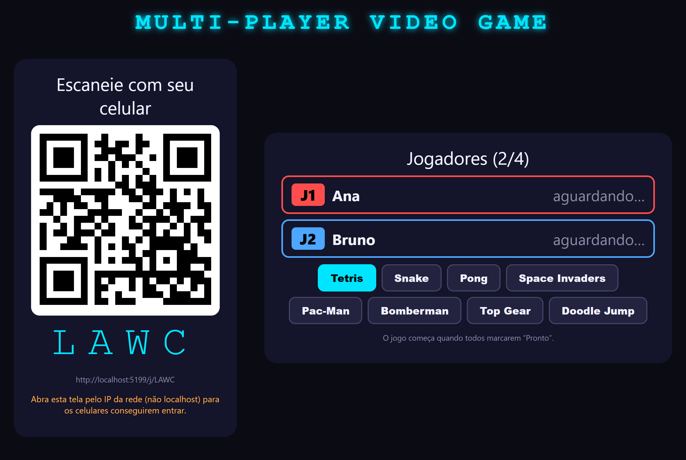
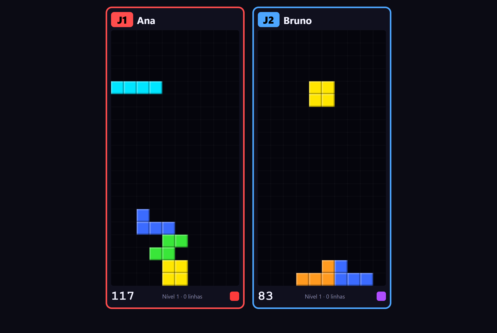
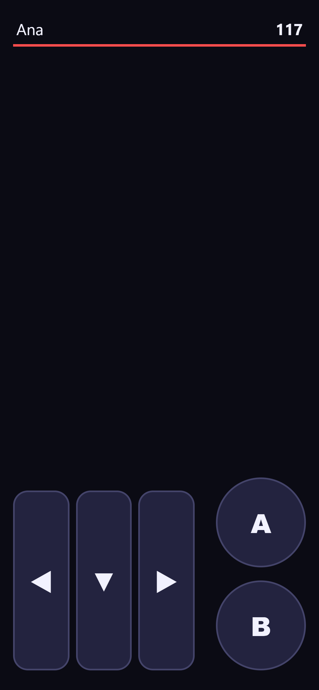

# 🎮 Multi-Player Video Game


**Retro party games in the browser.** The TV shows the game and each player uses their phone as a controller: scan a QR code, type a name and play. No login, no install, 1–4 players. The lobby offers 8 games (Tetris, Snake, Pong, Space Invaders, Pac-Man, Bomberman, Top Gear and Doodle Jump); Tetris is the most complete.

<p align="center">
  <br/>
  
</p>
<p align="center">
  
</p>

## Highlights

- **Authoritative server:** game rules run on the server at 30 ticks/s; TV and phones only render and send input, which keeps everyone in sync.
- **Real-time over WebSockets** (Socket.io): rooms, lobby with "ready" and countdown, per-player game over and a final ranking.
- **Pluggable game engines:** a `GameEngine` interface lets new games plug into a room. Each game is an engine behind that interface: Tetris came first, and Snake, Pong, Space Invaders, Pac-Man, Bomberman, Top Gear and Doodle Jump followed.
- **Zero-friction onboarding:** the QR code opens `/j/<ROOM_CODE>` on the phone.
- **Server unit tests** with Vitest.

## Architecture

| Folder | Content |
|---|---|
| `server/` | Node + Express + Socket.io: Tetris rules, rooms, 30-tick game loop |
| `web/` | Vite + React: `/` is the TV, `/j/CODE` is the phone controller |
| `shared/` | Types shared between server and web |
| `docs/` | Vision, decisions, architecture, roadmap, testing strategy (in Portuguese) |

## Running locally

```bash
npm install
npm run dev     # server on :3001, web on :5173
npm test        # server tests (Vitest)
```

Open the TV view using your **network IP** (e.g. `http://192.168.x.x:5173`), not `localhost`, because the QR code uses the page address. Phones join by scanning the QR on the same network.

Optional env vars: `VITE_PUBLIC_URL` (public URL encoded in the QR), `VITE_SERVER_URL` (server URL, default `http://<host>:3001`), `CORS_ORIGIN` and `PORT` (server).

## Status

Phase 1 (Tetris MVP + lobby) is largely implemented: rooms, lobby, Tetris for 1–4 players, rankings, phone controller and local high scores. Still to do: frontend and E2E tests, visual polish, deployment (Railway + Vercel), CI, and validation sessions with 4 real players. See [docs/roadmap.md](docs/roadmap.md).

## Documentation

| Document | Purpose |
|---|---|
| [docs/visao.md](docs/visao.md) | Product vision, audience, scope |
| [docs/decisoes.md](docs/decisoes.md) | Product rules and decisions (source of truth) |
| [docs/arquitetura.md](docs/arquitetura.md) | Architecture, code structure, WebSocket protocol |
| [docs/roadmap.md](docs/roadmap.md) | Phases, status and risks |
| [docs/testes.md](docs/testes.md) | Testing strategy |
